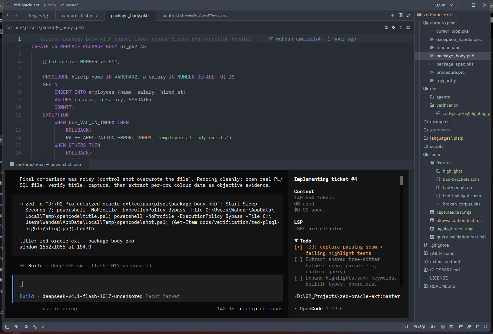

# Oracle PL/SQL for Zed

A [Zed](https://zed.dev) extension that adds `PL/SQL` language support: a Tree-sitter
grammar ([`njank/tree-sitter-plsql`](https://github.com/njank/tree-sitter-plsql), MIT),
syntax highlighting, bracket matching and auto-closing, line-pattern indentation,
comment toggling, and structural snippets.

Status: early MVP (grammar, syntax highlighting, bracket matching, line-pattern
indentation, comment toggling, structural snippets).



## Features

- **`PL/SQL` language**: files ending in `.pls`, `.pks`, `.pkb`, `.prc`, `.fnc`, `.trg`,
  `.typ` open as `PL/SQL`; extensionless files whose first line matches the PL/SQL
  stored-program pattern do too.
- **Syntax highlighting** (`languages/plsql/highlights.scm`): keywords, builtin types
  (`VARCHAR2`, `NUMBER`, `PLS_INTEGER`, `CLOB`, ...), line and block comments, string and
  numeric literals, operators.
- **Bracket matching and auto-closing** (`languages/plsql/brackets.scm`, `config.toml`):
  `(`, `'`, `"` auto-close; auto-closing is suppressed when the cursor sits just before `)`.
- **Line-pattern indentation** (`config.toml`): bodies indent after `DECLARE`, `BEGIN`,
  `THEN`, `LOOP`, `ELSE`, unit-header `IS`/`AS`, and `CASE`; `END`, `END IF`, `END LOOP`,
  `END CASE`, `EXCEPTION`, `ELSIF`, `WHEN`, `ELSE`, and `BEGIN` outdent.
- **Comment toggling** with `--`.

### Snippets

Registered in `extension.toml` as `./snippets/plsql.json`; type a prefix inside a PL/SQL
file and accept it from the completion menu. All 13 are structural only.

| Snippet | Prefix | Expands to |
| --- | --- | --- |
| Package spec | `pkg-spec` | `CREATE OR REPLACE PACKAGE ... AS ... END ...;` |
| Package body | `pkg-body` | `CREATE OR REPLACE PACKAGE BODY ... AS ... END ...;` |
| Procedure | `proc` | `CREATE OR REPLACE PROCEDURE ... IS BEGIN ... EXCEPTION ... END ...;` |
| Function | `func` | `CREATE OR REPLACE FUNCTION ... RETURN ... IS ... END ...;` |
| Trigger | `trg` | `CREATE OR REPLACE TRIGGER ... BEFORE INSERT ON ... FOR EACH ROW ...` |
| Cursor declaration | `cur` | `CURSOR ... IS SELECT ... FROM ... WHERE ...;` |
| Cursor FOR loop | `cur-loop` | `FOR ... IN ... LOOP ... END LOOP;` |
| Basic loop | `loop` | `LOOP ... EXIT WHEN ...; END LOOP;` |
| While loop | `while` | `WHILE ... LOOP ... END LOOP;` |
| Numeric FOR loop | `for-loop` | `FOR ... IN ... LOOP ... EXIT WHEN ...; END LOOP;` |
| IF statement | `if` | `IF ... THEN ... ELSIF ... THEN ... ELSE ... END IF;` |
| CASE statement | `case` | `CASE ... WHEN ... THEN ... ELSE ... END CASE;` |
| Exception handler | `exc` | `EXCEPTION WHEN ... THEN ... WHEN OTHERS THEN ...` |

No DML and no builtin-function snippets; the set stays out of the way of a future
language server.

## Installation (dev extension)

1. In Zed, open the command palette and run `zed: install dev extension`, then select this repository's directory.
2. Open a file with one of these extensions: `.pls`, `.pks`, `.pkb`, `.prc`, `.fnc`, `.trg`, `.typ`. The status bar should show `PL/SQL`.

## Development

### Query validation

Tree-sitter queries name grammar nodes by hand, so a typo in `highlights.scm` silently
breaks highlighting in Zed. `scripts/validate-queries.mjs` catches that before you open
the editor: it parses the PL/SQL corpus in `corpus/plsql/`, then checks every node
referenced by the query files against the pinned grammar's `node-types.json`, checks that
each query compiles, and checks `config.toml` against the fields Zed requires on each
`[[brackets]]` entry. Capture names (`@keyword`, `@type.builtin`, ...) are not checked
against a Zed allow-list, so a mistyped capture name is only caught by eye.

```sh
node scripts/validate-queries.mjs        # exit 0 = all good, 1 = problems, 2 = setup problem
node --test tests/                       # unit + end-to-end tests for the validator
```

Requirements: the `tree-sitter` CLI on `PATH` (0.25 or newer — the CLI pinned by the
grammar's own `package.json` is too old to check modern queries) and a C compiler (the
script builds the parser from `grammars/plsql` and caches the library next to it).
`grammars/` is cloned by Zed on demand and is not committed, so clone
`njank/tree-sitter-plsql` at the commit pinned in `extension.toml` into `grammars/plsql`
first if it is missing. The script also warns when the checkout is not at that commit.

Options: `--query <file>` (repeatable), `--config <file>`, `--corpus <dir>`,
`--grammar <dir>`, `--no-parse`.

### Manual smoke test

After `zed: install dev extension`, open each file in `corpus/plsql/` with the dev
extension enabled, then check:

1. The status bar shows `PL/SQL`.
2. Keywords, types, comments, and literals are highlighted.
3. Pressing Enter after a block opener indents, and a closer outdents (see
   `docs/verification/indentation.md`).
4. Each prefix from the snippet table expands (see `docs/verification/snippets.md`).
5. Toggling comments with `--` works.
6. `zed: open log` shows no extension errors.

### Opening `.sql` files as PL/SQL

Zed's built-in `SQL` keeps `.sql`. To opt a `.sql` script into `PL/SQL`, add to your Zed
`settings.json`:

```json
{"file_types": {"PL/SQL": ["*.sql"]}}
```

## Credits

The PL/SQL grammar is
[`njank/tree-sitter-plsql`](https://github.com/njank/tree-sitter-plsql) by njank, the
actively maintained continuation of
[`andreasmaierde/tree-sitter-plsql`](https://github.com/andreasmaierde/tree-sitter-plsql)
by Andreas Maier. Both are MIT-licensed. Thanks to both authors for the grammar this
extension builds on.

## Limitations

- Files with the `.sql` extension keep opening as SQL (Zed's SQL support). To open them
  as PL/SQL, use the language selector in the status bar or the `file_types` setting
  above.
- Files with no extension are detected as PL/SQL when their first line starts with
  `CREATE [OR REPLACE] PROCEDURE|FUNCTION|PACKAGE|TRIGGER|TYPE`; `DECLARE` alone does not
  trigger detection. Files whose extension is already claimed by another language (e.g.
  `.sql`, `.txt`) keep that language.
- Anchored types such as `table.column%TYPE` are only partially highlighted, and
  dotted type names (`schema.type`) are not highlighted as types.
- Indentation is driven by line patterns, not a Tree-sitter `indents.scm` query. Nested
  block openers and closers align correctly, but indentation inside a multi-line
  statement (for example a wrapped `SELECT`) is inherited from the previous line rather
  than computed from syntax.
- No language server: no completion, diagnostics, go-to-definition, or formatting.

## License

MIT. See [LICENSE](LICENSE).
